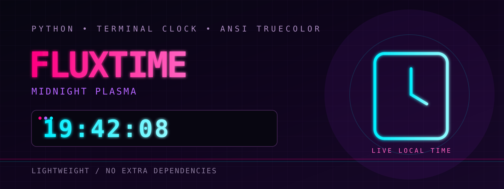
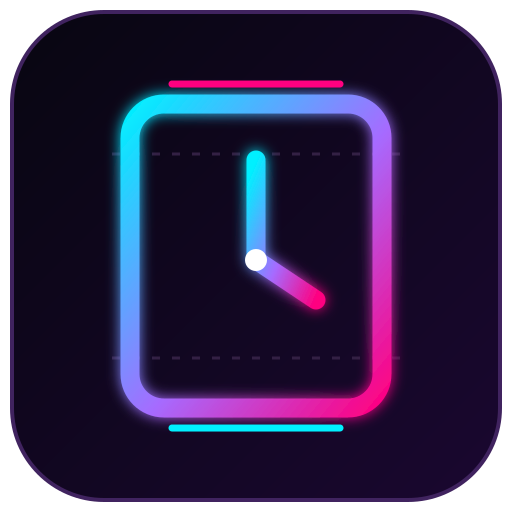

<!--
  FluxTime — Midnight Plasma Terminal Clock
  Banner ASCII provided by the project author.
-->

<div align="center">



```text
██╗    ██╗███████╗██╗      ██████╗ ██████╗ ███╗   ███╗███████╗    ████████╗ ██████╗     ████████╗██╗  ██╗███████╗    ███████╗██╗     ██╗   ██╗██╗  ██╗████████╗██╗███╗   ███╗███████╗    ██████╗ ███████╗██████╗  ██████╗ ███████╗██╗████████╗ ██████╗ ██████╗ ██╗   ██╗
██║    ██║██╔════╝██║     ██╔════╝██╔═══██╗████╗ ████║██╔════╝    ╚══██╔══╝██╔═══██╗    ╚══██╔══╝██║  ██║██╔════╝    ██╔════╝██║     ██║   ██║╚██╗██╔╝╚══██╔══╝██║████╗ ████║██╔════╝    ██╔══██╗██╔════╝██╔══██╗██╔═══██╗██╔════╝██║╚══██╔══╝██╔═══██╗██╔══██╗╚██╗ ██╔╝
██║ █╗ ██║█████╗  ██║     ██║     ██║   ██║██╔████╔██║█████╗         ██║   ██║   ██║       ██║   ███████║█████╗      █████╗  ██║     ██║   ██║ ╚███╔╝    ██║   ██║██╔████╔██║█████╗      ██████╔╝█████╗  ██████╔╝██║   ██║███████╗██║   ██║   ██║   ██║██████╔╝ ╚████╔╝ 
██║███╗██║██╔══╝  ██║     ██║     ██║   ██║██║╚██╔╝██║██╔══╝         ██║   ██║   ██║       ██║   ██╔══██║██╔══╝      ██╔══╝  ██║     ██║   ██║ ██╔██╗    ██║   ██║██║╚██╔╝██║██╔══╝      ██╔══██╗██╔══╝  ██╔═══╝ ██║   ██║╚════██║██║   ██║   ██║   ██║██╔══██╗  ╚██╔╝  
╚███╔███╔╝███████╗███████╗╚██████╗╚██████╔╝██║ ╚═╝ ██║███████╗       ██║   ╚██████╔╝       ██║   ██║  ██║███████╗    ██║     ███████╗╚██████╔╝██╔╝ ██╗   ██║   ██║██║ ╚═╝ ██║███████╗    ██║  ██║███████╗██║     ╚██████╔╝███████║██║   ██║   ╚██████╔╝██║  ██║   ██║   
 ╚══╝╚══╝ ╚══════╝╚══════╝ ╚═════╝ ╚═════╝ ╚═╝     ╚═╝╚══════╝       ╚═╝    ╚═════╝        ╚═╝   ╚═╝  ╚═╝╚══════╝    ╚═╝     ╚══════╝ ╚═════╝ ╚═╝  ╚═╝   ╚═╝   ╚═╝╚═╝     ╚═╝╚══════╝    ╚═╝  ╚═╝╚══════╝╚═╝      ╚═════╝ ╚══════╝╚═╝   ╚═╝    ╚═════╝ ╚═╝  ╚═╝   ╚═╝
```

### Un reloj digital futurista para la terminal

**Python · ANSI TrueColor · Midnight Plasma**

[Características](#características) · [Instalación](#instalación) · [Uso](#uso) · [Documentación](docs/USAGE.md) · [Contribuir](CONTRIBUTING.md)

</div>

---

## Acerca de FluxTime

**FluxTime** es un reloj digital en tiempo real para la terminal, creado en Python. Dibuja números grandes con caracteres de bloque y utiliza una paleta oscura con rosa neón, cian eléctrico y violeta.

El objetivo es sencillo: convertir la hora de la terminal en una pequeña experiencia visual futurista, sin dependencias externas ni instalaciones complicadas.

## Características

- **Hora en vivo:** muestra horas, minutos y segundos en formato de 24 horas.
- **Dígitos grandes:** números y separadores dibujados con caracteres de estilo ANSI Shadow.
- **Paleta Midnight Plasma:** rosa neón, cian, violeta y gris azulado sobre un fondo muy oscuro.
- **Fecha en español:** día de la semana, día del mes, mes y año.
- **Ligero:** utiliza solamente la biblioteca estándar de Python.
- **Sin configuración:** no necesita claves API, cuentas ni conexión a internet.
- **Salida sencilla:** presiona `Ctrl+C` para detenerlo.

## Identidad visual



FluxTime presenta un banner ASCII en rosa, un reloj grande en cian y la fecha en violeta. El aspecto final depende de la compatibilidad de tu terminal con las secuencias ANSI y los colores de 24 bits.

> El banner y el logotipo son gráficos vectoriales del proyecto, no una captura de pantalla del programa ejecutándose.

## Tabla de contenidos

- [Requisitos](#requisitos)
- [Instalación](#instalación)
- [Uso](#uso)
- [Controles](#controles)
- [Paleta visual](#paleta-visual)
- [Cómo funciona](#cómo-funciona)
- [Compatibilidad](#compatibilidad)
- [Estructura del proyecto](#estructura-del-proyecto)
- [Solución de problemas](#solución-de-problemas)
- [Contribuciones](#contribuciones)
- [Licencia](#licencia)
- [Autor](#autor)

## Requisitos

- Python 3.
- Una terminal que admita secuencias ANSI; para los colores previstos, se recomienda compatibilidad con ANSI TrueColor (24 bits).

No necesitas instalar paquetes con `pip`.

## Instalación

### Opción 1: descargar el archivo

1. Abre el repositorio de FluxTime.
2. Descarga `FluxTime.py`.
3. Guarda el archivo en una carpeta de tu elección.
4. Abre una terminal dentro de esa carpeta.

### Opción 2: clonar el repositorio

```bash
git clone https://github.com/programador777lolxddd-dot/FluxTime.git
cd FluxTime
```

## Uso

Ejecuta el programa con Python 3:

```bash
python3 FluxTime.py
```

En Windows, o en sistemas donde el comando `python` apunta a Python 3, puedes usar:

```bash
python FluxTime.py
```

El reloj se actualiza continuamente. Para detenerlo, presiona **Ctrl+C** en la terminal.

## Controles

| Acción | Control |
| --- | --- |
| Iniciar el reloj | Ejecutar el comando de Python |
| Detener el reloj | `Ctrl+C` |
| Actualizar la pantalla | Automático |

## Paleta visual

| Elemento | Color definido |
| --- | --- |
| Fondo | RGB `(10, 2, 20)` — azul/morado casi negro |
| Banner | RGB `(255, 0, 128)` — rosa neón |
| Hora | RGB `(0, 240, 255)` — cian eléctrico |
| Fecha | RGB `(180, 100, 255)` — violeta |
| Texto secundario | RGB `(120, 120, 160)` — gris azulado |

Los colores se aplican mediante secuencias ANSI TrueColor. La apariencia puede variar según la terminal y su configuración.

## Cómo funciona

1. Obtiene la hora local del sistema mediante `datetime.now()`.
2. Convierte la hora a texto con el formato de 24 horas.
3. Transforma cada dígito en filas de caracteres de bloque.
4. Construye una pantalla con el banner, el reloj y la fecha.
5. Limpia y vuelve a dibujar la terminal en un bucle.

El código usa los módulos estándar `os`, `sys`, `time` y `datetime`. No envía datos ni necesita servicios externos.

## Compatibilidad

- **Linux:** utiliza una terminal con soporte ANSI y TrueColor.
- **macOS:** utiliza una terminal con soporte ANSI y TrueColor.
- **Windows:** el código incluye una inicialización básica para ANSI; el resultado depende de la terminal y su configuración.

Si los colores no aparecen, prueba otra terminal compatible y verifica que el soporte de colores esté habilitado.

## Estructura del proyecto

```text
FluxTime/
├── FluxTime.py
├── README.md
├── LICENSE
├── CHANGELOG.md
├── CONTRIBUTING.md
├── CODE_OF_CONDUCT.md
├── SECURITY.md
├── .gitignore
└── docs/
    └── USAGE.md
```

## Solución de problemas

**El comando `python3` no existe.**  
Prueba `python FluxTime.py` o instala Python 3 desde una fuente oficial.

**Los colores se ven diferentes o no aparecen.**  
Usa una terminal compatible con ANSI TrueColor (24 bits).

**El banner o el reloj se ve desalineado.**  
Prueba una fuente monoespaciada y una ventana de terminal más ancha.

**Quiero detener el programa.**  
Vuelve a la terminal donde está ejecutándose y presiona `Ctrl+C`.

## Contribuciones

¡Las mejoras, correcciones y sugerencias son bienvenidas! Antes de enviar cambios, revisa [CONTRIBUTING.md](CONTRIBUTING.md). Para reportar un problema, utiliza la sección **Issues** del repositorio.

## Licencia

FluxTime se distribuye bajo la licencia **MIT**. Lee el archivo [LICENSE](LICENSE) para conocer los términos completos.

## Autor

Creado por **Programador en español** en 2026.

Repositorio: https://github.com/programador777lolxddd-dot/FluxTime

---

<div align="center">

**FluxTime — la hora, en modo terminal.**

</div>
